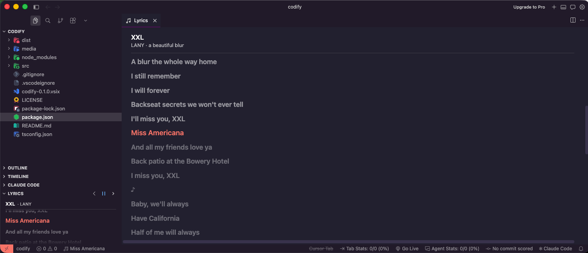
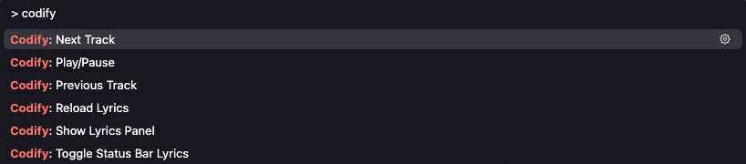

# Codify

Synced Spotify lyrics for the track you're playing — right inside VS Code or Cursor, while you code.

> **macOS only.** Codify reads the current track from the Spotify desktop app through AppleScript, which is only available on macOS.



- **LYRICS view in the Explorer sidebar**: the full lyrics, with the active line highlighted and kept near the top third. Adapts to the section height and aligns left or right to match the sidebar position.
- **Playback controls** in the LYRICS view title: ‹ previous, ▶/⏸ play/pause, › next.
- **Status bar**: the line being sung right now (click it to open the panel).
- **Lyrics panel**: a large view next to the editor.

## How it works

- The current track is read from the Spotify desktop app through AppleScript (`osascript`) — no login or API key needed.
- Lyrics come from [LRCLIB](https://lrclib.net) (free, with synced lyrics) and are cached per track.
- Spotify ads (free tier) are detected and skipped.

## Lyrics availability

Lyrics come from [LRCLIB](https://lrclib.net), a free, community-maintained database, so coverage varies from track to track:

- **Not every track is available.** Newer releases and less popular songs may not be in LRCLIB yet — Codify then shows *No lyrics found*.
- **Some tracks only have plain lyrics.** Without timestamps they are shown as static text (*lyrics (not synced)*) instead of following the song.
- **Timing can be slightly off** when the lyrics were made for a different version of the track (remaster, single vs. album). Use `codify.offsetMs` to adjust it.

Missing or out-of-date lyrics can be added or fixed on [lrclib.net](https://lrclib.net); run `Codify: Reload Lyrics` afterwards to fetch the new version.

## Requirements

- macOS with the Spotify desktop app.
- VS Code 1.80+ or Cursor.
- Automation permission: on first run macOS asks whether your editor (Visual Studio Code or Cursor) may control Spotify → **Allow**.
  Each editor asks separately. You can change this later in *System Settings → Privacy & Security → Automation*.

## Commands (Cmd+Shift+P)

- `Codify: Show Lyrics Panel`
- `Codify: Toggle Status Bar Lyrics`
- `Codify: Reload Lyrics`
- `Codify: Play/Pause` / `Next Track` / `Previous Track`



## Settings

| Setting | Default | Description |
| --- | --- | --- |
| `codify.showInStatusBar` | `true` | Show the active lyric line in the status bar. |
| `codify.sidebarAlign` | `auto` | `auto` follows the sidebar position; or force `left` / `right`. |
| `codify.offsetMs` | `0` | Shift lyric timing; positive values show lines earlier. |
| `codify.pollIntervalMs` | `1000` | How often to read the Spotify player state. |

## Project structure

Written in TypeScript and bundled with esbuild into `dist/`.

```
src/
  extension.ts      activation and command registration
  controller.ts     polling, lyric timing, status bar and webview state
  spotify.ts        AppleScript bridge to the Spotify app
  lyrics.ts         LRCLIB lookup and LRC parsing
  webviewHtml.ts    HTML shell for the panel and sidebar
  shared/types.ts   types shared by the extension and the webview (incl. messages)
  webview/main.ts   lyrics rendering and auto-scroll inside the webview
media/
  webview.css       panel and sidebar styles
  music-*.svg       lyrics panel tab icon
```

## Development

```bash
npm install
npm run typecheck   # type-check the extension and the webview
npm run build       # type-check + bundle into dist/
npm run watch       # rebuild dist/extension.js on change
```

## Install

Build the package first (this also runs the TypeScript build):

```bash
npm install
npm run package                        # produces codify-0.1.0.vsix
```

Then install it in your editor:

| Editor | Command line | From the UI |
| --- | --- | --- |
| VS Code | `code --install-extension codify-0.1.0.vsix --force` | Extensions → `···` → **Install from VSIX…** |
| Cursor | `cursor --install-extension codify-0.1.0.vsix --force` | Extensions → `···` → **Install from VSIX…** |

Then run `Developer: Reload Window`.

> The `code` command is available after running *Shell Command: Install 'code' command in PATH* from the VS Code command palette.

The LYRICS view appears in the Explorer sidebar. Drag it to the top once if you like — the editor remembers its position.

